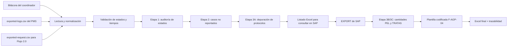

# Manual funcional y técnico del Revisor de Bitácoras

> Documento de referencia del comportamiento actual del sistema.
>
> Describe qué archivos recibe, cómo valida los estados del PMS, cómo reconstruye
> la fecha/hora de llegada y de salida, cómo dirige la auditoría, cómo cruza los
> protocolos con SAP y qué contiene el Excel final.

## 1. Propósito del sistema

El **Revisor de Bitácoras** transforma la bitácora diaria entregada por el
coordinador en una bitácora depurada, auditada y codificada con la plantilla
**F-AGP-04**, lista para continuar con el cargue operativo en HSEQ/SIG.

El sistema no se limita a convertir un Excel. Durante el proceso:

1. identifica la fecha de corte de la bitácora;
2. contrasta los estados de `Flujo Nuevo`, `Flujo Viejo` y `Flujo 2.0` con el
   historial del PMS y, para el último, con el snapshot de solicitudes;
3. verifica que las salidas de dibujo correspondan al profesional reportado;
4. reconstruye el ciclo de dibujo para obtener la fecha/hora de llegada y de
   salida;
5. recupera las observaciones de devolución;
6. detecta movimientos de cierre o devolución que no fueron reportados en la
   bitácora;
7. guía al auditor para resolver las diferencias una sola vez;
8. depura y valida protocolos;
9. cruza esos protocolos con el `EXPORT` de SAP;
10. calcula las cantidades PEL/TRATAS por protocolo y el total de elementos;
11. limpia marcadores que generan ruido;
12. copia la información a la plantilla oficial y agrega hojas de trazabilidad.

El resultado principal es:

```text
Produccion DD-MM-AAAA - validada.xlsx
```

Adicionalmente, la interfaz permite descargar un CSV con las decisiones de la
auditoría guiada.

## 2. Alcance actual

### 2.1 Funcionalidades incluidas

- Validación de estados en `Flujo Nuevo`, `Flujo Viejo` y `Flujo 2.0`.
- Confirmación de `Contract Drawing Completed` desde `exported-request.csv`.
- Captura separada de llegada, entrega de ODM y entrega de dibujo en Flujo 2.0.
- Validación del profesional que realizó una salida de dibujo.
- Captura de fecha/hora de llegada y salida del ciclo de dibujo.
- Recuperación de la observación correspondiente a una devolución.
- Detección y tratamiento de casos no reportados.
- Revisión de AGP y protocolos digitados durante la auditoría.
- Validación de protocolos múltiples separados por punto y coma.
- Conteo de PEL/TRATAS desde SAP.
- Validación de cantidades en `Correo-Rotulacion` para solicitudes por correo
  finalizadas.
- Traslado y limpieza de `Odm`, `Correo-Rotulacion` y `PNC`.
- Generación del formato codificado F-AGP-04 con el logo de OCA Global.
- Registro de decisiones e imágenes de soporte dentro del Excel final.

### 2.2 Funcionalidades que todavía no realiza

- No calcula por sí mismo el ANS contractual completo.
- No descuenta festivos, horarios no laborales, pausas ni bloqueos.
- No convierte las horas del PMS entre zonas horarias. Usa exactamente la fecha
  y hora contenida en `date_created`.
- No valida todavía el flujo de negocio de la hoja `PNC`; solamente la traslada
  y la limpia.
- No conserva una auditoría en una base de datos. El expediente vive en la
  sesión activa de Streamlit hasta que se descarga el resultado o se reinicia.

Las fechas de llegada y salida generadas por este sistema son insumos para una
futura conciliación de ANS, no el cálculo final del ANS.

## 3. Vista general del proceso



La interfaz obliga a cerrar cada etapa antes de habilitar la siguiente. Así se
evita repetir acciones: primero se establece qué filas y estados son válidos;
después se incorporan los omitidos; solamente entonces se construye el listado
definitivo de protocolos que se debe consultar en SAP.

## 4. Archivos de entrada

### 4.1 Bitácora del coordinador

Debe ser un archivo `.xlsx` cuyo nombre contenga una fecha con el formato:

```text
DD-MM-AAAA
```

Ejemplo:

```text
Produccion 23-09-2026.xlsx
```

Si el nombre contiene más de una fecha con ese formato, el sistema toma la
última. Esta fecha se denomina **fecha de producción** o **fecha de corte**.

Las hojas base obligatorias para iniciar son:

- `Flujo Nuevo`;
- `Flujo Viejo`.

En ambas hojas deben encontrarse, dentro de las primeras veinte filas, los
encabezados:

- `QR`;
- `ESTADO DE LA OT`.

Cuando existen, también se leen:

- `USUARIO`;
- `CÓDIGO DEL INCREMENTO (AGP)`;
- `PROTOCOLO`;
- `CANTIDAD PEL`;
- `CANTIDAD TRATAS`;
- `OBSERVACIONES`.

`Flujo 2.0` es opcional. Cuando existe, también debe contener `QR` y
`ESTADO DE LA OT`; para el estado `3-ODM Asignadas` se leen además `ESTADO
SECUNDARIO`, `ODM`, AGP y protocolo. Las demás hojas se conservan para la
generación del formato final, pero no participan en la validación inicial de
estados.

### 4.2 Log del PMS

El segundo archivo es un CSV cuyo nombre contiene normalmente
`exported-logs`. La fecha escrita en el nombre del CSV no se usa como fecha de
corte.

El archivo se interpreta con estas condiciones:

- separador: punto y coma (`;`);
- codificación esperada: UTF-8, con o sin BOM;
- procesamiento por bloques de 250.000 filas para soportar archivos grandes;
- las líneas dañadas que Pandas no puede interpretar se omiten;
- las fechas se convierten admitiendo formatos mixtos.

Columnas obligatorias:

| Columna | Uso |
|---|---|
| `request_code` | QR del caso |
| `final_state` | Estado al que llegó el movimiento |
| `date_created` | Fecha y hora del evento |

Columnas opcionales, pero necesarias para algunas funciones:

| Columna | Uso |
|---|---|
| `initial_state` | Comprueba si hubo una transición real y no una repetición técnica |
| `comments` | Recupera la observación de las devoluciones |
| `username` | Identifica al usuario que ejecutó el movimiento |
| `user_created_last_name` | Nombre visible del profesional en PMS |

Si las columnas opcionales no existen, el archivo todavía se puede leer, pero
se reduce la precisión de la validación de profesionales, transiciones,
observaciones o tiempos.

### 4.3 Exported Request del PMS

Solo es obligatorio cuando la bitácora contiene la hoja `Flujo 2.0`. Debe ser
un CSV separado por punto y coma. El sistema cruza únicamente los QR de esa
hoja y usa estas columnas:

| Columna | Uso |
|---|---|
| `request_code` | QR del caso |
| `contract_drawing_completed` | Confirma si PMS tiene marcada la entrega del dibujo |
| `new_fulfillment_process` | Comprueba que la solicitud pertenece al flujo nuevo de cumplimiento |
| `status` | Estado actual informativo del request |
| `date_created` | Permite escoger el snapshot más reciente si el QR está repetido |
| `odm`, `agp_project`, `agp_increment`, `protocol` | Metadatos auxiliares para trazabilidad |

`request_code` y `contract_drawing_completed` son obligatorias. Los valores
booleanos aceptan `true/false`, `1/0`, `yes/no` y `sí/no`. El archivo es un
snapshot actual: no reemplaza la fecha histórica del log; únicamente confirma
la marca Drawing Completed.

### 4.4 EXPORT de SAP

El `EXPORT` se solicita únicamente al llegar a la etapa 3. Debe ser un `.xlsx`.
El sistema busca primero una hoja llamada `Sheet1`; si no existe, usa la primera
hoja disponible.

Dentro de las primeras diez filas deben aparecer:

| Columna | Uso |
|---|---|
| `PROTOCOLLO AP` | Protocolo al que pertenece el elemento |
| `GIS GUID` | Identificador único del PEL o la TRATA |
| `TIPO PEL O TRATT` | Clasificación `P` o `T` |

El conteo no corresponde al número bruto de filas. Para cada protocolo se
cuentan los `GIS GUID` **únicos** clasificados como `P` y los `GIS GUID` únicos
clasificados como `T`. Los registros sin protocolo, sin GUID o con otro tipo se
ignoran.

### 4.5 Plantilla F-AGP-04

La plantilla está incluida dentro de la aplicación. El usuario no tiene que
cargarla. La aplicación también conserva una ruta histórica de Drive como
respaldo para ejecución local.

La plantilla aporta:

- codificación F-AGP-04;
- encabezados, colores, bordes y tablas oficiales;
- estructura de las hojas operativas;
- logo de OCA Global.

## 5. Normalizaciones previas

Antes de comparar, el sistema normaliza varios tipos de datos.

### 5.1 Estados

Las diferencias de mayúsculas, espacios, guiones y guiones bajos se toleran para
los estados conocidos. Por ejemplo:

- `2.7`, `2.7 Dibujo finalizado` y `2.7-Dibujo finalizado` se convierten en
  `2.7-Dibujo finalizado`;
- `Drawing Review` se convierte en `drawing_review`;
- `Verify Formats` se convierte en `verify_formats`.

### 5.2 Identificadores

- Un identificador numérico leído como `1000165388.0` se convierte en
  `1000165388`.
- Se eliminan espacios externos.
- Un valor vacío o `NaN` se trata como vacío.

### 5.3 Nombres de profesionales

La comparación de nombres:

- ignora mayúsculas y minúsculas;
- ignora tildes;
- ignora puntos y otros signos;
- tolera que PMS presente primero los apellidos;
- reconoce identificadores de usuario configurados, incluso con prefijo `CO`;
- reconoce alias conocidos;
- admite que PMS omita una parte del nombre si ambos valores conservan al menos
  tres componentes inequívocos y uno es subconjunto del otro.

Así, valores como estos pueden reconocerse como la misma persona:

```text
Manuel Fernando Sánchez Mondragón
Sanchez mondragon.manuel fernando
SANCHEZ MONDRAGON MANUEL FERNANDO
```

La comparación de profesionales se usa para seleccionar la salida del caso que
realmente corresponde al usuario reportado en la bitácora.

### 5.4 Corrección segura de QR truncados

El sistema puede corregir automáticamente un QR de la bitácora al que le falte
exactamente un carácter alfanumérico al final. La corrección solo se hace cuando
se cumplen simultáneamente estas condiciones:

1. el QR exacto de la bitácora no aparece en ninguna parte del log;
2. PMS contiene una referencia formada por el QR de la bitácora más un único
   carácter final;
3. existe una sola candidata posible;
4. la candidata tiene, en la fecha de producción, un estado permitido para la
   hoja correspondiente.

Si existen dos candidatas o si el QR exacto aparece en el log, no se corrige. La
modificación automática queda registrada como `Prevalidación QR` en la hoja de
auditoría.

## 6. Familias de estados de dibujo

El sistema separa los estados por flujo y por función dentro del ciclo.

| Flujo | Estados de llegada | Estados de salida |
|---|---|---|
| Flujo Nuevo | `drawing_request`, `assigned_draftsman` | `verify_formats`, `drawing_review` |
| Flujo Viejo | `2.5-Enviado a dibujo`, `2.6-Dibujante asignado` | `2-Valorizado`, `2.6.1-Dibujo en revision`, `2.7-Dibujo finalizado` |
| Flujo 2.0 | `2.5-Enviado a dibujo`, `2.6-Dibujante asignado` | entrega ODM: `3-ODM Asignadas`; dibujo: repetición posterior del estado vigente por el profesional |

Interpretación funcional:

- **Llegada:** el caso entra o vuelve a entrar a la cola de trabajo de dibujo.
- **Salida:** el profesional entrega, finaliza o devuelve el caso desde dibujo.

`1.3-RG Gestionado EEC` no se considera una salida de dibujo y ni siquiera forma
parte de los estados que se cargan en la línea temporal de dibujo.

## 7. Cobertura temporal y fecha de corte

Antes de validar, se revisa el valor mínimo y máximo de `date_created` en todo el
CSV.

La fecha de producción debe estar comprendida entre la primera y la última fecha
real del log. Si no lo está, la aplicación detiene el proceso.

Ejemplo:

```text
Bitácora: 23/09/2026
Última fecha real del log: 22/09/2026
Resultado: el proceso se detiene y solicita un log más reciente.
```

Esto evita aceptar falsamente que un caso no tuvo movimiento cuando en realidad
el CSV fue descargado antes de la jornada que se quiere revisar.

Para el corte diario se usa el intervalo:

```text
fecha de producción 00:00:00 <= evento < día siguiente 00:00:00
```

Los movimientos posteriores a la fecha de producción no cambian la validación
histórica. Sin embargo, para reconstruir la llegada se pueden consultar eventos
anteriores a esa fecha, porque un ciclo puede haber comenzado en una jornada
previa.

## 8. Cómo se valida el estado reportado

### 8.1 Filtro por familia de flujo

Para un QR de `Flujo Nuevo` solo se consideran los estados configurados como
nuevos. Para un QR de `Flujo Viejo` solo se consideran los estados antiguos.
Para `Flujo 2.0` se conserva el historial completo del QR, porque después de
entregar la ODM el territorio puede moverlo a estados que no pertenecen a
dibujo y la posterior entrega del dibujo puede repetir cualquiera de ellos.

Esto evita que un estado de otra familia altere la comparación.

### 8.2 Filas que no representan una salida

Si la bitácora reporta un estado que no es una salida de dibujo, la comparación
usa el último movimiento permitido del día para ese QR.

### 8.3 Filas que reportan una salida de dibujo

Cuando la bitácora reporta una salida, el sistema usa una regla más estricta:

1. revisa la línea temporal del QR;
2. busca una transición de salida ocurrida exactamente en la fecha de
   producción;
3. comprueba que sea una transición de negocio real;
4. intenta encontrarla a nombre del profesional informado en `USUARIO`;
5. selecciona la más reciente si existen varias candidatas.

Una fila técnica en la que `initial_state` y `final_state` son iguales se ignora
como salida.

Para `Flujo Nuevo`, una salida de negocio normalmente debe cumplir:

```text
initial_state = assigned_draftsman
final_state = verify_formats o drawing_review
```

También se admite un `initial_state` vacío, porque algunos extractos no lo traen.

Para `Flujo Viejo`:

- `2-Valorizado` solo se acepta automáticamente como salida cuando proviene de
  `2.6-Dibujante asignado`;
- `2.6.1-Dibujo en revision` y `2.7-Dibujo finalizado` se aceptan cuando
  provienen de `2.6-Dibujante asignado` o cuando el estado inicial está vacío.

### 8.4 Resultados posibles

| Resultado | Significado |
|---|---|
| `Coincide` | El estado real del día coincide con la bitácora y corresponde al profesional |
| `No coincide` | Se encontró un estado de salida distinto al reportado |
| `Sin movimiento en la fecha` | No se encontró un movimiento válido ese día |
| `Sin QR` | La fila no contiene QR |
| `Revisión obligatoria: profesional PMS diferente` | Existe una salida, pero no fue realizada por el profesional reportado |
| `Revisión obligatoria: evidencia temporal insuficiente` | Flujo 2.0 tiene la marca de dibujo, pero el log no permite fecharla con seguridad |

Como contexto, la hoja de resultados también muestra el último estado permitido
disponible antes del final del día. Ese dato es informativo y no reemplaza la
exigencia de que exista un movimiento en la fecha de producción.

## 9. Detección detallada de fecha/hora de salida

La salida no se obtiene buscando cualquier aparición de `2.7` o
`drawing_review`. Se selecciona un **evento de salida de negocio**.

El procedimiento es:

1. tomar únicamente los eventos del QR hasta el final de la fecha de producción;
2. conservar los estados pertenecientes a la familia de dibujo de la hoja;
3. buscar eventos de salida ocurridos durante el día de producción;
4. eliminar las filas sin cambio real de estado;
5. comprobar las transiciones válidas descritas en la sección anterior;
6. comparar el actor del PMS con el profesional de la bitácora;
7. si hay más de una salida válida del mismo profesional, tomar la más reciente;
8. usar su `date_created` como `FECHA/HORA DE SALIDA`.

Cuando la fila ya coincide, la salida buscada debe coincidir también con el
estado reportado. Cuando el estado todavía está en auditoría, la aplicación puede
mostrar como propuesta la última salida de negocio del profesional, aunque el
estado sea distinto, para que el auditor decida.

Si no se encuentra una salida del profesional, el resultado temporal queda como:

```text
Salida del profesional no localizada
```

## 10. Detección detallada de fecha/hora de llegada

La fecha de llegada se reconstruye **después** de seleccionar la salida. Esto es
importante porque un mismo QR puede entrar y salir de dibujo varias veces.

### 10.1 Regla del ciclo

Para la salida seleccionada:

1. se ordenan todos los eventos de dibujo del QR que ocurrieron antes o en la
   hora de salida;
2. se buscan todas las salidas de negocio reales anteriores;
3. la salida real inmediatamente anterior se convierte en el límite inferior
   del ciclo actual;
4. dentro del intervalo posterior a ese límite y anterior a la salida
   seleccionada se buscan estados de llegada;
5. se descartan llegadas técnicas sin cambio de estado;
6. se toma la **primera llegada válida** de ese intervalo;
7. su `date_created` se usa como `FECHA/HORA DE LLEGADA`.

En forma resumida:

```text
salida real anterior | primera llegada del ciclo ... salida seleccionada
                     ^ FECHA/HORA DE LLEGADA       ^ FECHA/HORA DE SALIDA
```

La lista autorizada de profesionales para casos no reportados **no** se usa para
marcar el límite del ciclo. Cualquier salida real anterior cierra el ciclo
anterior, independientemente del usuario que la haya generado. De lo contrario,
una nueva entrada podría heredar erróneamente la llegada de un ciclo viejo.

### 10.2 Por qué se toma la primera llegada del intervalo

Un ciclo nuevo puede verse así:

```text
drawing_request -> assigned_draftsman -> drawing_review
```

La llegada real del ciclo es `drawing_request`, aunque después haya pasado por
`assigned_draftsman`. Por eso se toma la primera llegada posterior a la salida
anterior.

En cambio, cuando un caso ya había salido y posteriormente vuelve corregido, el
ciclo puede ser:

```text
verify_formats -> estados externos -> assigned_draftsman -> drawing_review
```

La salida `verify_formats` cierra el ciclo anterior. En el nuevo intervalo ya no
existe un `drawing_request`; por tanto, la llegada del nuevo ciclo es
`assigned_draftsman`.

La misma lógica se aplica en flujo viejo:

```text
2.7 anterior -> estados externos -> 2.6 -> 2.7 actual
```

La llegada actual será el nuevo `2.6`, no una asignación perteneciente al ciclo
anterior.

### 10.3 Ejemplos

#### Ejemplo A: primera entrada en flujo nuevo

```text
08:00 drawing_request
09:10 assigned_draftsman
16:40 drawing_review
```

Resultado:

- llegada: 08:00 (`drawing_request`);
- salida: 16:40 (`drawing_review`).

#### Ejemplo B: reentrada después de una devolución

```text
Día 1 15:00 verify_formats
Día 2 08:30 assigned_draftsman
Día 2 14:20 drawing_review
```

Resultado del ciclo del día 2:

- límite del ciclo: salida del día 1 a las 15:00;
- llegada: día 2 a las 08:30 (`assigned_draftsman`);
- salida: día 2 a las 14:20 (`drawing_review`).

#### Ejemplo C: flujo viejo con asignación previa

```text
07:50 2.5-Enviado a dibujo
08:15 2.6-Dibujante asignado
17:05 2.7-Dibujo finalizado
```

Resultado:

- llegada: 07:50 (`2.5-Enviado a dibujo`);
- salida: 17:05 (`2.7-Dibujo finalizado`).

#### Ejemplo D: salida sin llegada localizada

```text
16:00 assigned_draftsman -> verify_formats
```

Si el log cargado no contiene ninguna entrada válida posterior a la salida real
anterior, se conserva la salida de las 16:00, la llegada queda vacía y el sistema
registra:

```text
Salida encontrada; llegada no localizada
```

### 10.4 Estados del resultado temporal

| Resultado | Interpretación |
|---|---|
| `Ciclo capturado desde PMS` | Se localizaron llegada y salida |
| `Salida encontrada; llegada no localizada` | Se localizó la salida, pero no una entrada válida del ciclo |
| `Salida del profesional no localizada` | No se pudo asociar una salida al usuario reportado |
| `No aplica: estado sin salida` | El estado reportado no es de salida de dibujo |
| `Fechas confirmadas en auditoría` | El auditor confirmó o corrigió manualmente ambas fechas |

La fuente queda identificada como `PMS` o `Auditoría`.

## 11. Regla especial de Flujo 2.0

Flujo 2.0 combina la entrega prioritaria de una ODM con una entrega de dibujo
que puede ser simultánea o posterior. Por eso no se trata como una única salida.

### 11.1 Entrega de ODM

El hito de ODM se localiza buscando, antes del final de la fecha de corte, la
transición más reciente:

```text
2-Valorizado o 2.6-Dibujante asignado -> 3-ODM Asignadas
```

Su `date_created` se guarda en `FECHA/HORA ENTREGA ODM`. La llegada es la primera
aparición real de `2.5-Enviado a dibujo` o `2.6-Dibujante asignado` posterior a
la salida previa y anterior a esa ODM. Cuando el flujo pasa directamente de
`2-Valorizado` a estado 3, sin eventos 2.5/2.6 intermedios, la entrada más
reciente a `2-Valorizado` se usa como llegada de ese ciclo.

### 11.2 Estado secundario pendiente

Si la bitácora reporta:

```text
ESTADO DE LA OT = 3-ODM Asignadas
ESTADO SECUNDARIO = ODM_Creada-Pendiente_Dibujo
```

la fila coincide cuando la ODM existe y `Contract Drawing Completed` sigue en
`False`. También puede coincidir históricamente si hoy la marca está en `True`,
pero el log demuestra que la repetición de entrega del dibujo ocurrió después
de la fecha de corte. La fecha de dibujo queda vacía.

### 11.3 Estado secundario finalizado

Si el estado secundario es `ODM_Creada-Dibujo_Finalizado`, el request debe tener
`Contract Drawing Completed=True`. Se distinguen dos escenarios:

1. **Entrega simultánea:** la transición a estado 3 ocurrió el día de corte y no
   existe una repetición posterior atribuible al dibujo. La hora de ODM se usa
   también como hora de dibujo.
2. **Entrega posterior:** después de la ODM aparece una fila con
   `initial_state = final_state`, hecha por el mismo profesional reportado. Esa
   repetición fecha la entrega del dibujo, aunque el estado repetido sea 3, 4 u
   otro estado posterior del territorio.

No se consideran entrega de dibujo las repeticiones cuyo comentario indique
asignación, reasignación o marcación de nodos. Tampoco se acepta automáticamente
una repetición hecha por otro profesional.

### 11.4 Evidencia ambigua y auditoría

Si el request dice `True`, pero la ODM ocurrió antes del día de corte y el log
no contiene una repetición demostrable del profesional, el sistema no inventa
una hora: genera `Revisión obligatoria: evidencia temporal insuficiente`.
Durante la auditoría se confirman por separado:

- fecha/hora de llegada;
- fecha/hora de entrega de ODM;
- fecha/hora de entrega de dibujo cuando el subestado es finalizado.

La entrega de dibujo no puede ser anterior a la ODM y la ODM no puede ser
anterior a la llegada.

## 12. Confirmación manual de tiempos en la interfaz

Si una fila presenta una diferencia de estado, la tarjeta de la etapa 1 muestra:

- llegada propuesta;
- salida propuesta;
- estado de llegada;
- estado reportado;
- estado hallado en PMS;
- profesional de la bitácora;
- profesional del evento PMS.

Al conservar o corregir una salida de dibujo, el auditor debe confirmar ambas
fechas en formato:

```text
DD/MM/AAAA HH:MM:SS
```

Reglas:

- no se puede diligenciar solamente una de las dos;
- la llegada no puede ser posterior a la salida;
- las fechas confirmadas quedan con fuente `Auditoría`;
- el sistema no vuelve a sobrescribirlas con la propuesta automática;
- ambas quedan escritas como fechas reales de Excel y registradas en
  `Auditoria guiada`.

Actualmente la etapa 1 solo abre tarjetas para diferencias de **estado o
profesional**. Si un estado coincide pero el resultado temporal informa que no se
localizó la llegada, la fila no abre una tarjeta independiente solo por ese
motivo. La novedad permanece visible en `Resultado Validacion` para revisión
posterior.

Los casos no reportados que se agregan en la etapa 2 vuelven a pasar por la
reconstrucción automática de tiempos. Esa etapa no ofrece todavía campos manuales
para corregir una llegada o salida que no haya podido reconstruirse.

## 13. Recuperación de observaciones de devolución

Los estados tratados como devolución son:

- `verify_formats`;
- `2.6.1-Dibujo en revision`;
- `2-Valorizado`.

Para estos casos el sistema no toma simplemente el último comentario del QR. La
búsqueda exige:

1. mismo QR;
2. mismo estado de devolución aprobado en la bitácora;
3. mismo profesional;
4. comentario no vacío;
5. fecha/hora menor o igual a la salida seleccionada;
6. si hay varias opciones, se toma la más reciente.

Esta regla evita que una respuesta posterior o un movimiento distinto sustituya
la devolución que el dibujante reportó en la fecha de corte.

Los comentarios del PMS se limpian antes de escribirlos:

- etiquetas HTML se eliminan;
- `<br>`, cierres de párrafo, `div` o lista se convierten en saltos de línea;
- entidades HTML se decodifican;
- espacios repetidos se compactan;
- marcadores aislados `N/A`, `No aplica`, `S/M` o `SM` se convierten en vacío.

Si la devolución coincide, la observación se escribe en la hoja operativa. Si el
estado no coincide, la observación no se aplica automáticamente hasta que el
auditor conserve o corrija el estado.

## 14. Etapa 1: auditoría guiada de estados

La primera pantalla presenta tarjetas resumen con:

- filas que coinciden;
- filas pendientes de decisión;
- filas ya revisadas.

Las coincidencias se aprueban automáticamente. Las diferencias se muestran una
por una para evitar revisar varias veces el mismo caso.

### 14.1 Conservar bitácora

Se usa cuando el auditor confirma que el dato reportado por el profesional es el
correcto, aunque la comparación automática haya encontrado otra situación.

Para una salida de dibujo se deben confirmar llegada y salida. Para una
devolución se recupera nuevamente la observación del mismo estado.

Resultado interno:

```text
Aprobado: conservar bitácora
```

### 14.2 Corregir

Permite seleccionar el estado correcto.

- Si el nuevo estado es `2.7-Dibujo finalizado` o `drawing_review`, se solicitan
  AGP y protocolo.
- Si existen varios AGP, deben separarse con `;`.
- Si existen varios protocolos, deben separarse con `;`.
- Todo protocolo debe comenzar por `1000`.
- Las cantidades PEL/TRATAS no se piden en este momento; se obtienen después con
  SAP.
- Si el nuevo estado es una devolución, no se solicitan AGP ni protocolo y se
  recupera la observación del PMS.
- Al cambiar a un estado final o de devolución se limpian las cantidades antiguas
  para impedir que sobrevivan valores no validados.

Resultado interno:

```text
Corregido en auditoría
```

### 14.3 Excluir

La fila no pasa a las hojas de flujo del Excel listo para cargar. La decisión y
su nota sí quedan registradas en la trazabilidad.

Resultado interno:

```text
Excluido en auditoría
```

### 14.4 Cierre de la etapa

El botón para continuar solo se habilita cuando cada diferencia tiene una
decisión guardada. Al cerrar:

- se modifican las celdas necesarias en una copia de trabajo del libro;
- se recalculan los tiempos;
- se incorporan las observaciones aprobadas;
- se agregan las decisiones al expediente de auditoría.

## 15. Etapa 2: casos no reportados

### 15.1 Qué se considera un caso no reportado

Se buscan QRs que no aparecen en ninguna de las dos hojas de flujo de la bitácora
y que tuvieron, en la fecha de producción, uno de estos movimientos:

- `2.6.1-Dibujo en revision`;
- `2.7-Dibujo finalizado`;
- `verify_formats`;
- `drawing_review`.

Si un QR tuvo varios movimientos objetivo el mismo día, se conserva el más
reciente.

Para cierres `2.7-Dibujo finalizado` y `drawing_review`, el actor debe pertenecer
al grupo autorizado de profesionales de dibujo configurado en el sistema. Para
las devoluciones `2.6.1` y `verify_formats` no se aplica ese filtro.

Un QR corregido automáticamente por truncamiento se retira de la lista de no
reportados para no presentarlo dos veces.

### 15.2 Decisiones disponibles

#### Agregar a la bitácora

El auditor selecciona la hoja destino y diligencia:

- origen de actualización;
- profesional;
- elementos estimados, si los conoce;
- AGP y protocolo únicamente cuando el estado es de dibujo finalizado.

Para devoluciones no se solicitan AGP ni protocolo. Se escribe la observación
recuperada del PMS.

Orígenes disponibles:

- E1;
- Proyectos;
- Convenios: Concesiones;
- Telecontrol;
- Indisponibles;
- Equipos Nuevos;
- Conexiones;
- Mantenimiento Programado;
- PQRs;
- Boletines Pagos;
- C100;
- SMEG;
- IPPC;
- Solicitud por correo;
- Rotulación;
- Otro;
- Concesiones.

La fila se agrega al final de la hoja elegida y participa en la etapa de
protocolos si corresponde.

#### No agregar

El caso no se incorpora al flujo y su motivo queda en `Auditoria guiada`.

### 15.3 Grupo autorizado para cierres no reportados

Actualmente el sistema reconoce, por nombre, alias o identificador PMS, a:

- Adrian Ignacio Sanchez Vacca;
- Daniela Forero Fierro;
- David Andres Luna Yela;
- Jenny Lorena Porras Cano;
- Johan Estiven Silva Silva;
- Jorge Luis Urrego Castañeda;
- Jose Pablo Siachoque Rodriguez;
- Kevin Alejandro Torres Perdomo;
- Luisa Fernanda Guatavita Perez;
- Manuel Fernando Sanchez Mondragon;
- Maria Alejandra Sierra Almario;
- Maria Camila Leal Cardenas;
- Stefany Colorado Fresneda;
- Valery Steffany Cagua Marroquin;
- William Fernando Uribe Bayona;
- Yesika Arevalo Pinzon;
- Yiceth Loreyna Ayala Guio;
- Andres Felipe Perez Naranjo.

Esta lista limita únicamente la detección de cierres no reportados. No limita el
cierre de ciclos para el cálculo de la llegada.

## 16. Etapa 3: protocolos y cantidades

El cargador del `EXPORT` permanece bloqueado durante las etapas 1 y 2. Se
habilita únicamente cuando la auditoría llega a protocolos.

### 16.1 Referencias que participan

Se incluyen:

- filas aprobadas de `Flujo Nuevo` con `drawing_review`;
- filas aprobadas de `Flujo Viejo` con `2.7-Dibujo finalizado`;
- filas aprobadas de `Flujo 2.0` en `3-ODM Asignadas` cuyo estado secundario sea
  `ODM_Creada-Dibujo_Finalizado`;
- filas de `Correo-Rotulacion` cuyo origen sea `Solicitud por correo` y cuyo
  estado sea `Finalizado`.

No participan:

- devoluciones;
- filas excluidas;
- correos en otro estado;
- registros cuyo origen sea `Rotulación`;
- registros de `PNC`.

### 16.2 Prevalidación

Antes de generar el listado para SAP, la aplicación detecta referencias con:

- protocolo vacío;
- protocolos separados con coma, barra vertical o salto de línea;
- varios números sin punto y coma;
- números concatenados;
- protocolos que no comienzan por `1000`.

Cada referencia se corrige en la misma interfaz o se justifica como `No aplica`.
No se puede avanzar mientras quede una referencia pendiente.

### 16.3 Reglas para varios protocolos

Los protocolos deben escribirse así:

```text
1000162837;1000162838
```

El punto y coma conserva la posición de cada protocolo. El sistema elimina
duplicados exactos conservando el orden de la primera aparición.

Los AGP múltiples siguen la misma convención:

```text
2000133299;2000134328
```

### 16.4 Listado de solicitud para SAP

La aplicación genera:

```text
Protocolos DD-MM-AAAA.xlsx
```

Este libro contiene:

- `Protocolos`: tabla de una columna con protocolos únicos;
- `Detalle`: relación del protocolo con hoja, QR o referencia y estado.

El auditor usa el listado para realizar una sola consulta en SAP y descargar el
`EXPORT`.

### 16.5 Conteo y correspondencia posicional

Para cada protocolo se cuentan los GUID únicos `P` y `T`.

Ejemplo:

```text
PROTOCOLO:       1000165388;1000165391
CANTIDAD PEL:    8;64
CANTIDAD TRATAS: 1;44
```

La posición se conserva:

| Posición | Protocolo | PEL | TRATAS |
|---:|---|---:|---:|
| 1 | 1000165388 | 8 | 1 |
| 2 | 1000165391 | 64 | 44 |

`TOTAL ELEMENTOS` es un solo número con la suma completa:

```text
8 + 64 + 1 + 44 = 117
```

No debe escribirse `72;108` ni otro desglose en `TOTAL ELEMENTOS`. El desglose
solo se conserva en PEL y TRATAS.

### 16.6 Resultados de cantidades

| Resultado | Significado |
|---|---|
| `Coincide con EXPORT` | Las cantidades numéricas reportadas coinciden con SAP |
| `Actualizada desde EXPORT` | SAP tiene cantidades válidas distintas y el sistema las sustituirá |
| `Sin protocolo` | La referencia no tiene protocolo |
| `Protocolo no encontrado en EXPORT` | Ningún protocolo de la celda apareció |
| `Protocolos incompletos en EXPORT` | Algunos aparecieron y otros faltan |
| `Separador inválido entre protocolos: usa ;` | Los códigos no cumplen la convención |
| `Protocolo inválido: debe iniciar por 1000` | Al menos un código tiene prefijo inválido |
| `No aplica por estado` | El estado no requiere conteo |
| `No aplica por auditoría` | El auditor justificó que no corresponde contar |

Si solo aparece una parte de los protocolos, la interfaz puede mostrar el
subtotal hallado y signos `?` en las posiciones faltantes. El Excel final no se
genera hasta resolver todos los protocolos ausentes.

### 16.7 Decisiones para protocolos ausentes

#### Corregir protocolo

Permite sustituir el código incorrecto por uno o varios códigos. La sustitución
se aplica a todas las referencias elegibles de flujos y correos donde aparezca el
token exacto. Luego se repite el cruce con el EXPORT ya cargado.

#### Registrar cantidades manualmente

El auditor informa PEL y TRATAS, incluyendo cero cuando corresponda. Exige:

- justificación escrita;
- imagen de soporte.

Las cantidades se integran al cálculo como valores auditados y la imagen se
incrusta en `Soportes protocolos`.

#### No aplica

Exige justificación. Para efectos del total, ese protocolo aporta cero PEL y cero
TRATAS. La imagen es opcional.

## 17. Validación de Correo-Rotulacion

Solamente se actualizan cantidades cuando se cumplen las dos condiciones:

```text
ORIGEN DE ACTUALIZACIÓN = Solicitud por correo
ESTADO DE LA OT = Finalizado
```

La comparación de estos dos campos ignora tildes, mayúsculas y espacios
redundantes.

Las filas con origen `Rotulación` o con estados diferentes no se cruzan contra
SAP. Los resultados elegibles se detallan en `Validacion Correos`.

## 18. Limpieza de las hojas operativas

Antes de construir el libro final se limpian estas hojas:

- `Flujo Nuevo`;
- `Flujo Viejo`;
- `Flujo 2.0`;
- `Odm`;
- `Correo-Rotulacion`;
- `PNC`.

En cualquier columna se eliminan cuando aparecen como valor aislado:

- `N/A`;
- `S/N`;
- `0` numérico o textual.

Las fórmulas no se eliminan. Tampoco se borran las cantidades cero calculadas o
auditadas por el sistema, porque esas celdas se protegen durante la limpieza.

En `OBSERVACIONES` también se retiran marcadores aislados:

- `N/A`;
- `No aplica`;
- `S/M`;
- `SM`.

En `PNC` esa limpieza ampliada se aplica a toda la hoja. La hoja PNC se copia con
su información desde `FECHA DE LLEGADA` hasta `FECHA DE REVISIÓN`, pero todavía
no participa en las reglas de estados ni protocolos.

También se eliminan del formato de cargue las columnas auxiliares antiguas:

- `FECHA DE LLEGADA`;
- `FECHA ENTREGADO`;
- `CONTROL ANS`;
- `VALIDA`;
- `CONFIRMA`.

Después se agregan las columnas oficiales del control temporal actual:

- `FECHA/HORA DE LLEGADA`;
- `FECHA/HORA DE SALIDA`.

En `Flujo 2.0`, en lugar de una sola salida, se agregan:

- `FECHA/HORA DE LLEGADA`;
- `FECHA/HORA ENTREGA ODM`;
- `FECHA/HORA ENTREGA DIBUJO`.

## 19. Construcción del Excel final

### 19.1 Filas que pasan al cargue

En `Flujo Nuevo`, `Flujo Viejo` y `Flujo 2.0` solo permanecen filas con uno de estos
resultados:

- `Coincide`;
- `Aprobado: conservar bitácora`;
- `Corregido en auditoría`.

Las filas excluidas no se copian a los flujos finales, aunque su decisión queda
en la trazabilidad.

`Odm`, `Correo-Rotulacion` y `PNC` se trasladan a la plantilla y se limpian, pero
no se filtran con la validación de estados de dibujo.

### 19.2 Cantidades y totales

Cuando las cantidades fueron confirmadas, actualizadas o justificadas:

- PEL se escribe con su desglose posicional;
- TRATAS se escribe con su desglose posicional;
- `TOTAL ELEMENTOS` se escribe como la suma numérica de todos los PEL y todas
  las TRATAS.

Para filas no enriquecidas:

- si PEL/TRATAS contienen valores separados por `;`, el sistema intenta sumar
  todos los tokens y deja un total numérico;
- si son celdas numéricas sencillas, deja una fórmula de suma;
- si ambas están vacías, la fórmula devuelve vacío.

### 19.3 Formato y logo

Los registros se copian sobre las hojas codificadas de la plantilla. Se
reconstruyen las tablas de Excel, se conservan estilos, se ajusta el encabezado
para las nuevas columnas de tiempos y se inserta nuevamente el logo de OCA
Global en `A1` de las hojas codificadas.

El libro queda configurado para recalcular fórmulas al abrirse en Excel.

## 20. Hojas entregadas

El archivo final conserva las hojas de la plantilla y agrega o reconstruye las
siguientes hojas de control.

### 20.1 Hojas operativas

| Hoja | Tratamiento |
|---|---|
| `Flujo Nuevo` | Estados auditados, observaciones, tiempos y cantidades; solo filas aprobadas |
| `Flujo Viejo` | Estados auditados, observaciones, tiempos y cantidades; solo filas aprobadas |
| `Flujo 2.0` | Estado y subestado auditados; llegada, ODM y dibujo separados; cantidades solo cuando el dibujo está finalizado |
| `Odm` | Traslado al formato y limpieza |
| `Correo-Rotulacion` | Traslado, limpieza y cantidades para solicitudes elegibles |
| `PNC` | Traslado y limpieza, sin validación adicional por ahora |

### 20.2 Resultado Validacion

Incluye por fila:

- hoja y número de fila original;
- QR;
- estado reportado;
- estado PMS del día y fecha/hora;
- último estado anterior o igual al corte;
- resultado de estado;
- profesional de bitácora y profesional PMS;
- estado secundario reportado;
- estado y fecha/hora de llegada;
- fecha/hora de salida;
- fecha/hora de entrega de ODM y fecha/hora de entrega de dibujo;
- marca Drawing Completed, estado actual del request y evidencia usada para Flujo 2.0;
- AGP y ODM;
- resultado y fuente de tiempos;
- protocolo;
- cantidades reportadas y cantidades de SAP;
- resultado de cantidades;
- observación PMS y acción aplicada.

Los colores diferencian aprobaciones, actualizaciones, advertencias y errores.

### 20.3 Validacion Correos

Detalla exclusivamente las solicitudes por correo finalizadas que participaron
en el cruce de protocolos.

### 20.4 Casos no reportados

La hoja siempre existe. En el flujo guiado actual, todos los casos detectados
deben resolverse antes de generar el archivo. Los agregados pasan a su hoja de
flujo y los descartados quedan en la auditoría; por eso esta hoja se entrega
normalmente sin pendientes y muestra un mensaje de control.

### 20.5 Auditoria guiada

Conserva las decisiones manuales y correcciones automáticas:

- etapa;
- hoja o flujo;
- QR o referencia;
- decisión;
- estado inicial y final;
- AGP;
- protocolo;
- fecha/hora de llegada;
- fecha/hora de salida;
- detalle o justificación.

Las coincidencias automáticas que no requirieron intervención no producen una
fila en esta hoja; su evidencia está en `Resultado Validacion`.

### 20.6 Soportes protocolos

Solo se crea cuando existen decisiones sobre protocolos ausentes —cantidades
manuales o `No aplica`—. Incluye:

- protocolo;
- decisión;
- PEL y TRATAS manuales;
- justificación;
- nombre del archivo;
- imagen incrustada.

## 21. Comportamiento de la interfaz

### 21.1 Panel lateral

Al iniciar muestra:

1. cargador de bitácora;
2. cargador del log PMS;
3. cargador de `exported-request.csv`, necesario si existe `Flujo 2.0`;
4. cargador del EXPORT de SAP bloqueado.

Después de iniciar la auditoría, los tres primeros cargadores quedan bloqueados
para impedir que se mezclen archivos de expedientes diferentes.

El cargador de SAP:

- permanece bloqueado en etapas 1 y 2;
- se habilita en la etapa 3;
- vuelve a bloquearse al generar el resultado final.

`Reiniciar con otros archivos` elimina el expediente de la sesión actual.

### 21.2 Indicador de progreso

La parte superior muestra cuatro pasos:

```text
1. Estados -> 2. No reportados -> 3. Protocolos y cantidades -> 4. Excel final
```

Los pasos terminados aparecen marcados, el actual aparece resaltado y no se
puede saltar una etapa con pendientes.

### 21.3 Tarjetas de auditoría

Cada hallazgo se presenta en una tarjeta individual con navegación anterior y
siguiente, contador de progreso y botón para guardar. La decisión permanece en
la sesión aunque el usuario navegue entre tarjetas.

### 21.4 Resultado final en pantalla

La última etapa muestra:

- número de filas aprobadas;
- número de filas excluidas;
- cantidad de decisiones auditadas;
- tabla del resultado final;
- tabla de cantidades;
- tabla de auditoría realizada;
- botón para descargar el Excel;
- botón para descargar la trazabilidad en CSV.

## 22. Persistencia, privacidad y ejecución

El expediente se mantiene en `st.session_state`. Esto significa:

- navegar dentro de la misma sesión conserva decisiones;
- cargar el EXPORT después de descargar el listado no borra las etapas previas;
- reiniciar la aplicación, cerrar completamente el servidor o abrir otra sesión
  puede perder el expediente que todavía no se haya descargado.

En la instalación local, el servidor escucha exclusivamente en:

```text
127.0.0.1
```

Por tanto, no queda publicado para otros equipos de la red. En un despliegue en
Streamlit Cloud, los archivos se procesan en el servidor del despliegue y deben
aplicarse las políticas corporativas correspondientes.

## 23. Controles y limitaciones que debe conocer el auditor

1. **La fecha del nombre manda.** Una bitácora bien diligenciada pero mal
   nombrada se validará contra el día equivocado o no podrá iniciar.
2. **El nombre del log no garantiza cobertura.** La cobertura se comprueba con
   `date_created`.
3. **Los tiempos dependen de la historia disponible.** Si el log no trae la
   llegada del ciclo, la salida puede existir y la llegada quedar vacía.
4. **Los tiempos no son ANS calculado.** No aplican calendario laboral ni
   descuentos de bloqueo.
5. **El profesional es parte de la evidencia.** Una salida de otro usuario abre
   revisión obligatoria aunque el texto del estado coincida.
6. **Los protocolos múltiples son posicionales.** Protocolo, PEL y TRATAS deben
   mantener el mismo orden.
7. **El total no es posicional.** `TOTAL ELEMENTOS` siempre es una suma única.
8. **Las decisiones manuales requieren criterio humano.** El sistema conserva la
   justificación, pero no puede verificar por sí mismo una imagen de soporte.
9. **La sesión no es una base de datos.** Se debe descargar el Excel y la
   trazabilidad antes de cerrar por completo la aplicación.
10. **PNC aún no se audita.** Su presencia en el formato final no significa que
    sus tiempos o estados hayan sido validados.

## 24. Componentes principales del código

| Archivo o carpeta | Responsabilidad |
|---|---|
| `app.py` | Interfaz Streamlit, control de las cuatro etapas y sesión de auditoría |
| `bitacora.py` | Reglas de negocio, lectura de archivos, ciclos, validaciones y generación de Excel |
| `assets/` | Plantilla F-AGP-04 y recursos incluidos |
| `tests/test_bitacora.py` | Pruebas automatizadas de estados, tiempos, protocolos, limpieza y salida |
| `packaging/` | Construcción del ejecutable y del instalador de Windows |
| `INSTALACION.md` | Instrucciones para instalar y usar la versión de escritorio |

## 25. Resumen operativo corto

1. Cargar la bitácora y el `exported-logs.csv`; si existe `Flujo 2.0`, cargar
   también `exported-request.csv`.
2. Resolver todas las diferencias de estados y confirmar tiempos cuando la
   interfaz los solicite.
3. Decidir qué casos no reportados se agregan.
4. Corregir protocolos vacíos o mal escritos.
5. Descargar el listado Excel de protocolos.
6. Consultar SAP y cargar el `EXPORT`.
7. Resolver protocolos ausentes con corrección, cantidades manuales o `No
   aplica`.
8. Generar y descargar `Produccion DD-MM-AAAA - validada.xlsx`.
9. Descargar también la trazabilidad CSV cuando se requiera un soporte separado.
10. Revisar `Resultado Validacion`, especialmente cualquier tiempo marcado como
    llegada o salida no localizada.

